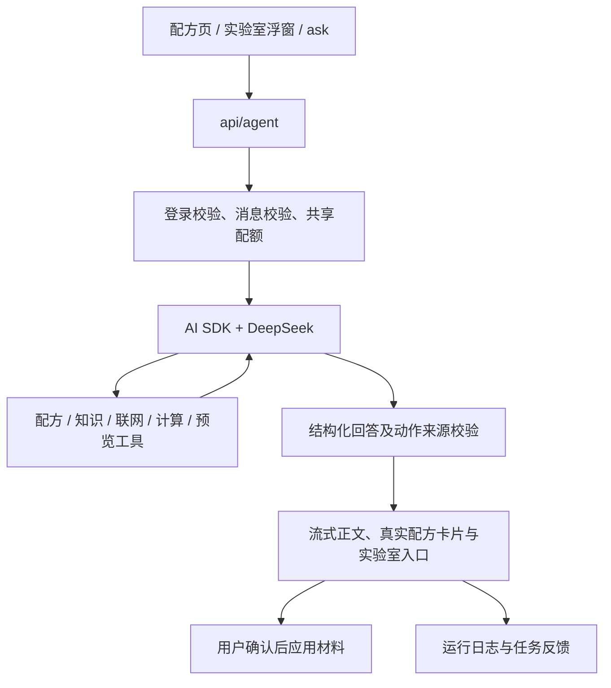

# 架构设计

核对日期：2026-10-14。本文描述当前默认路径。旧规则漏斗、单工具路由及 pending 状态设计见[历史档案](archive/README.md)，不作为当前默认引擎的介绍。

## 请求与交互

`src/app/api/agent/route.ts` 按协议分流：含 `messages` 的请求进入 `agent-next/route-handler.ts`，旧格式进入兼容引擎。默认界面为 `StreamingAssistantProvider` 和 `StreamingAskPage`；`ASSISTANT_RUNTIME=legacy` 可切换旧界面，API 继续兼容两种协议。

当前运行时限制最多五个模型步骤，请求整体超时 45 秒。客户端传入的历史只保留用户和助手文本，不信任客户端伪造的工具结果。页面背景不等同于用户实际拥有或已经倒入的材料。当前对话不是服务端长期记忆。

## 六个模型工具

工具定义的唯一实现位于 [tools.ts](../src/lib/agent-next/tools.ts)。

| 工具 | 作用与边界 |
| --- | --- |
| `get_recipe` | 查询可信配方及真实 ID |
| `find_recipes` | 按材料寻找候选，排除缺料并标注待准备材料 |
| `search_knowledge` | 查询 RAG 证据及其适用范围 |
| `search_web` | 受限联网检索与正文读取，不自动发布知识 |
| `calculate_adjustment` | 在已知数值条件下计算液体容量，不把未知量当零 |
| `preview_lab_change` | 生成预览，不能自动写入实验室 |

最终回答采用 `message` 与 `lab` 的结构化协议；实验室动作也可以来自经来源校验的 `lab` 字段，并非必须调用预览工具。真实配方链接由目录解析，材料来源需对应用户原话或本轮可信配方。覆盖已有实验室草稿需用户确认。

## 知识与数据

PostgreSQL / pgvector 保存知识向量；嵌入服务通过独立的 `RAG_EMBEDDING_*` 配置，切换聊天模型不等于更换嵌入空间。检索实现位于 `src/lib/knowledge/rag/`，聊天及搜索采用服务端 DeepSeek 配置，联网还支持显式配置 Tavily。

知识审核模块提供候选编辑、发布、驳回、合并和撤回。已审核内容与待审草稿分开。兼容引擎的 `searchAndCollect` 包含自动收集流程；当前 SDK 工具直接检索，不能把旧链路自动收集能力宣传为每轮默认助手都会执行。

Prisma 模型见 [schema.prisma](../prisma/schema.prisma)；迁移另含配额租约、RLS 与管理后台表。收藏与酒记使用配方身份关联；展示配方、试配参考量、用户实际制作记录属于不同事实。

## 管理、测试与版本边界

后台 `/admin/evaluations` 的当前 Agent 模式复用 `startAgent` 和 `agentUIStream`，完整运行后保存回答、工具记录和耗时；当前为单轮或独立案例，不提供多轮对话评测界面。指标和保留策略统一见[管理后台](admin-console.md)。

`src/lib/agent/` 中目录、配方和计算等能力仍被新引擎复用；`/ask/legacy` 和旧请求协议仍有兼容用途。`/ask/experimental` 由实验开关控制。只有 `legacy/` 中的 Vite 原型不参与当前 TypeScript 构建。
