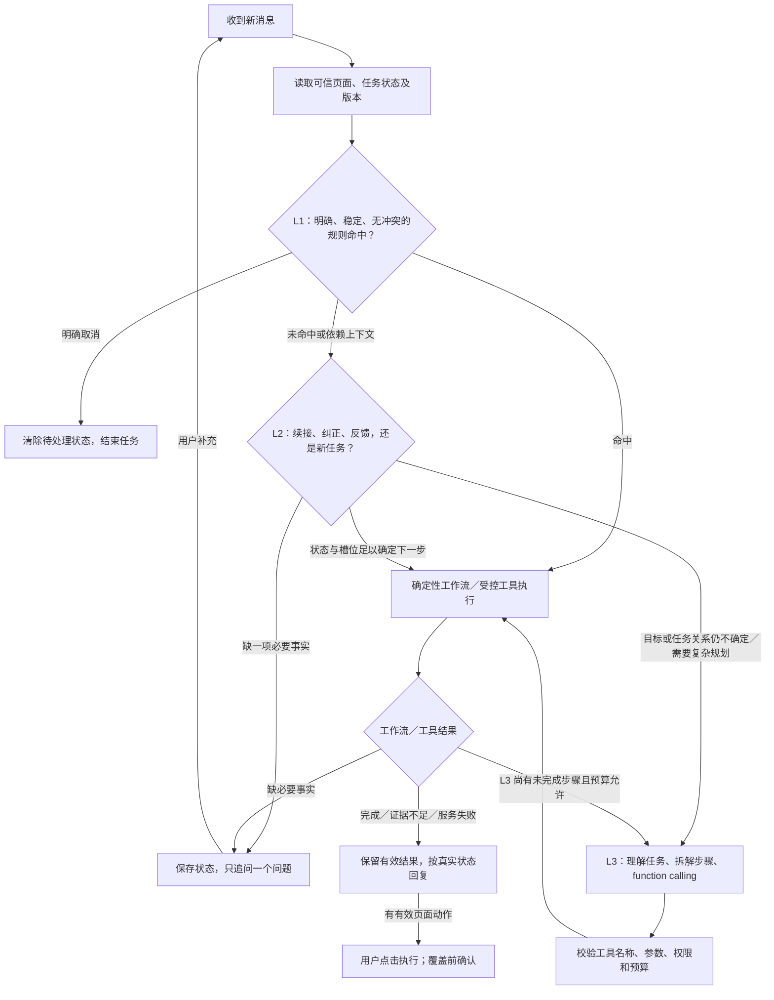

# Agent 决策、意图识别与边界

> 历史记录：保留当时的设计、结果及限制，不代表当前实现。当前版本见 [文档导航](../README.md)。

更新：2026-09-20。本文件定义 L1 规则层 → L2 上下文层 → L3 大模型层的意图识别与执行设计。v2 已有初步漏斗与 function calling 接入，完整任务状态及多步工具执行仍有待补齐，具体差距见第 6 节。v1 保留独立问答兼容；接口与验证范围见 [实现说明](companion-implementation.md)。

## 1. 三层漏斗决策图（目标流程）

说明：纯知识回答无需执行页面动作；只有返回有效操作入口时进入最后一步。这里的确认通常就是用户点击，覆盖实验室内容需要额外明确选择。

分层是内部处理方式，用户直接输入问题，无须选择层级或帮助菜单。请求由上向下流转，只有当前层无法可靠处理时才升级。L1/L2 命中后可以直接进入业务工作流，不要求经过 L3。

越往下，处理范围越广，预期推理成本越高。但“规则命中”只代表省去意图模型：其后若需要 RAG 或联网生成答案，仍然有调用成本。统计时应分别记录路由成本和整个任务成本，不预设命中率或节省比例。

## 2. 对话策略设置

### 1）功能目标与识别顺序

识别用户希望完成的任务，并判断这条消息是在提出新问题、回答追问、纠正事实、反馈结果还是取消。读取当前页面、当前酒和上一轮追问后再选工具，避免将“没有”“300”“是的”误判为选酒。

### 2）L1：少量、高置信的规则

采用关键词组合、正则和有限状态转移，仅覆盖边界明确的请求。单个词命中不足以结束路由；必须同时满足对象明确、没有否定或纠正冲突、没有遗漏的第二项需求。无法满足时继续进入 L2/L3。

从当前酒详情的使用场景出发，优先考虑“这杯怎么做”“缺一种材料怎么办”“能换成什么”“太甜／太烈怎么办”“步骤或改良入口在哪”。这些是首轮场景假设，实际频率待会话样本验证。其中涉及替换依据、实际用量和多轮指代的请求，即使常见，也不适合仅靠关键词直接回答。

| 首批规则范围 | 明确示例 | 命中后处理 | 不应直接截断的情况 |
| --- | --- | --- | --- |
| 取消当前任务 | “取消”“先不改了” | 清除追问与待执行动作，停止后续调用 | “不要取消”“先不改了，帮我看看另一杯”不能整句按取消结束 |
| 当前配方读取／入口 | “打开这杯的制作步骤”“配方在哪里？” | 读取已核验酒单或返回已注册步骤入口 | “这一步为什么要过滤”需要知识；“放多少冰”不能无依据补数值 |
| 明确指定酒单 | “打开玛格丽特” | 查询真实酒名并返回有效候选 | 多义名称、否定、纠正或同时问替换时继续下层 |
| 明确找功能 | “便利店改良入口在哪？” | 查询页面能力注册表 | “降低酒感应该加什么”属于调整需求，不能因“改”字跳到功能入口 |
| 缺料任务的明确起点 | “这杯缺一种材料” | 当前酒明确时进入缺料状态，仅询问缺料项 | 已说“没有青柠”不重问；“没有青柠，柠檬可以吗”保留完整替换问题 |

材料查酒、材料风味探索、故障描述可作为后续规则候选；先用真实样本确认冲突和边界再扩大覆盖。既有规则也应按此标准收敛，不因出现“我有”“分层”“酒感”等词就强制认定单一任务。

优先级和冲突处理：

1. 先处理明确取消及任务／页面版本失效；涉及饮用风险的约束对所有层生效，不受普通业务规则覆盖。
2. 识别否定、纠正、短答和多项需求。依赖旧状态的消息交给 L2；多个有效目标交给下层保留全部事项，不能“第一条正则命中就返回”。
3. 仅对剩余的单一明确请求应用规则。“已调好后分层”走故障工作流；一般性的“为什么会分层”走知识；“入口在哪”走操作。
4. 同一消息命中多个不兼容规则时升级，不靠文件中的先后顺序掩盖冲突。规则记录稳定 ID、适用前提、排除条件和反例，便于回归与撤回。

### 3）L2：以任务状态管理为核心

每轮先读取状态，再判断消息与当前任务的关系。明确的短答、类别选择和槽位补充直接由状态机处理；难以判断的表达可以使用轻量模型或向量匹配辅助识别“续接／新任务／纠正／反馈”，低置信时交 L3。辅助分类结果不能直接改写已确认事实，也不能跳过工具校验。

状态在各层之间共享，L1 命中或 L3 执行后同样需要更新。以下为目标状态内容，不代表当前 API 已有全部字段：

| 状态内容 | 用途与更新约束 |
| --- | --- |
| 任务类型、当前目标、阶段与状态 | 区分选酒、缺料替换、制作指导、故障排查；记录进行中、待补充、完成或取消 |
| 当前酒、taskId、背景版本 | 换杯隔离旧事实，拒绝迟到结果和过期动作；同杯明确转题时重置当前任务槽位 |
| 已填槽位及来源 | 分开保存缺料、替代候选、明确库存、实际材料、实际用量和操作；保存来源轮次、对象和单位 |
| 当前待回答字段与原问题 | “青柠”“没有”“300”只有能唯一对应当前字段时才填入；未知单位不猜 |
| 工具与页面操作记录 | 区分提出建议、提供入口、用户点击、实际执行结果；助手建议不能当作用户已做过 |
| 尚未完成的事项与已有结果 | 混合请求分别推进；一项失败不能抹掉另一项已得到的结果 |

状态处理顺序：先检查明确新目标；如为新任务，放下旧追问并隔离任务事实；否则处理明确纠正、结果反馈和上一轮回答。任务关系不明时保留原状态，交辅助分类或 L3，必要时只追问一个问题。

例如：“这杯已经分层了” → 等待实际材料；“金酒和养乐多” → 填入材料，等待实际操作；“一起倒进去搅了几下” → 合并原问题与事实后检索。若第二轮改问“打开玛格丽特”，应切换任务；若回答“还是分层”，保留已知事实，不重新问一遍，也不假定用户执行过建议。

### 4）L3：理解、拆解并调用工具

L3 接收原始需求、可信页面背景、L2 整理的任务状态及未解决事项。用于复杂表达、多目标请求、需要依赖工具结果才能决定下一步的任务。模型通过 function calling 输出工具名和结构化参数；应用用统一工具契约校验后执行，把真实结果回传，模型再决定继续、澄清或结束。

例如“帮我找一杯能用现有材料做的酒，再解释为什么上一杯分层”：分别处理酒库匹配与故障排查；前一项完成即可保留，后一项按缺失的实际事实追问。不能因有推荐结果而漏掉分层问题。

LangChain 承载工具定义和调用协议，具体职责与权限见第 4 节。L1/L2 的确定性工作流与 L3 共用业务能力。模型只输出可执行的结构化调用及必要澄清；自由生成的 URL、配方数值和执行成功声明均不能代替工具结果。多步执行设置调用上限、截止时间、重复调用检查和取消机制，已有结果足够时立即结束。

### 5）意图、功能调用与输出

以下为产品决策规则。v2 已接入共享匹配与受控页面动作；功能不存在时不能仅用文案宣称可操作。

| 意图分类 | 用户示例 | 工作流／知识调用 | 回复策略与展示 | 异常处理 | 验收 |
| --- | --- | --- | --- | --- | --- |
| 功能操作咨询 | “在哪里改成便利店版？” | 查页面能力注册表 | 说明功能位置；同页定位或跨页入口 | 目标不可用时不展示失效动作 | A19 |
| 材料搭配探索 | “橙汁加伏特加什么味道？” | 实验室交接 | 材料摘要和实验室按钮，不补用量 | 材料含义不明时澄清；覆盖按交互规范确认 | A03、A04 |
| 库内配方查找 | “这些材料能做什么？” | 现有匹配与排序 | 条件满足才问类别；最多三杯真实酒单，沿用 App 卡片点击展开 | 零结果明确说明，不自造配方 | A05、A06、A07 |
| 指定酒单查找 | “打开玛格丽特” | 真实配方及路由查询，支持部分名称和小幅拼写误差 | 具体酒单入口，不再询问类别 | 多个可能名称时展示候选或澄清；未知名称不造链接 | A07 |
| 当前配方缺料 | “这杯没有橙汁怎么办？”“没有椰奶，椰汁可以吗？” | 确认缺料和用户提出的替代候选或可用材料后查站内酒库／RAG，不足再联网 | 保留当前酒，给适用选项、差异和来源链接，保留快捷入口 | 具体候选已明确就直接检索；未知条件才追问；无证据不报精确比例 | A08、A09 |
| 制作步骤咨询 | “这杯放多少冰？” | 当前配方及制作知识 | 适用当前酒的说明和依据 | 必要事实缺失时只问一项 | A10 |
| 制作问题排查 | “已经混好了，为什么分层？” | 先确认实际材料和操作，再查站内资料，不足联网 | 可能原因、补救建议和来源链接 | 已知事实不重复问；不能用配方值代替实际操作 | A20 |
| 知识解释 | “为什么要过滤？” | RAG | 回答问题及引用，不强制选酒 | 无证据与查询失败分开提示 | A21、A15、A16 |
| 范围外 | “帮我写简历” | 不调业务或知识工具 | 简要说明助手可提供的帮助 | 不强行改写为调酒请求 | A22 |
| 不明确 | 无背景的“300” | 先澄清 | 询问数量对应对象 | 不猜单位、材料或任务 | A11 |

兼容 v1 代码意图枚举是 `recommend / knowledge / guide / troubleshoot / change / operate / out_of_scope / unclear`，不是上表名称。v2 使用独立意图与动作契约；当前与后续契约见 [AI 服务设计](ai-service-design.md)。

### 6）多轮策略

| 对话行为 | 用户示例与背景 | 状态处理 | 回复／下一步 |
| --- | --- | --- | --- |
| 新任务 | “再看看另一杯” | 明确新目标；换酒时隔离旧事实 | 按新目标选工具 |
| 回答追问 | 问缺什么后回答“橙汁” | 填充当前待回答字段 | 继续当前酒的缺料任务 |
| 纠正 | “刚才说错了，是30毫升” | 明确指代才替换旧事实 | 指代不清只追问，不改配方原始值 |
| 结果反馈 | “还是太甜了” | 保留目标，使用用户新陈述 | 必要时问实际操作，不假定建议已执行 |
| 取消 | “先不改了” | 清除追问及待执行动作 | 简短确认，不继续工具调用 |

任务关系为继续或新建。混合请求拆成待处理事项：选酒交由匹配，知识仍需回应；缺信息的事项可追问，已获得的有效知识不丢弃。不要为了一个未完成事项无限循环调用工具。验收见 A11–A14。

## 3. 候选和缺料规则

1. 先标准化材料名称；关键材料含义不明时问一个问题。
2. 调用现有工作流的匹配逻辑，按真实类别分组。材料齐全与缺材料候选不能混称“现在就能做”。
3. 只有经典、便利店两类都存在有效候选且用户未表明偏好时询问类别；指定经典或指定酒名不再问。
4. 输出至多三杯，材料齐全的候选先按工作流排序；其后可列出至少匹配两种且只缺一种材料的接近选择。每杯显示匹配原因、缺料事实和具体入口。零结果诚实说明，可提供现有筛选功能入口，不凭空造酒。
5. 用户在已选酒中问缺料时，保留该酒。先确认缺少哪种材料；已提出具体替代候选时直接检索适用性，不把候选当作已拥有，也不追问全部库存。未提出候选时才问手边有哪些可用材料。之后先查站内酒库和资料，证据不足再联网，给替代选项、风味差异及来源链接，并保留已有快捷入口。其他酒的材料组合只能作为搭配参考，不能据此声称等味、等量替换。
6. 实际故障先确认用户实际使用的材料和操作，再检索并建议。每次只问一项必要信息；用户开始新问题时停止沿用旧追问，取消清除待回答状态。

“缺一种材料”不是让助手重做首页选酒流程的触发器，而是用户明确求助或解释真实候选的约束。

## 4. 工具边界（目标）

| 工具职责 | 确定性约束 |
| --- | --- |
| 读取页面与当前配方 | 校验 recipeId、页面版本；编辑值不转成实际倒入量 |
| 查找页面能力 | 由注册表返回可执行动作，不接受模型生成 JS、选择器或任意 URL |
| 匹配库内配方 | 复用现有逻辑和数据，服务端组装身份与链接 |
| 检索制作知识 | 只使用通过版本检查的知识索引，输出证据与限制 |
| 提出页面交接 | 用户点击执行；覆盖前确认；过期动作失效 |

兼容 v1 工具仍为 `read_recipe / search_knowledge / check_capacity / clarify / finish`。v2 由意图识别后编排共享配方查找、匹配、受控动作和 RAG；没有另建六杯配方目录，也不把 v1 的六步循环上限误写为 v2 调用方式。具体见 [实现说明](companion-implementation.md)。

当前 v2 注册了 `find_recipes / open_recipe / explore_materials / locate_feature / change_recipe / guide_recipe / troubleshoot_recipe / answer_knowledge / clarify_request / reject_out_of_scope`。它们目前用于把单次 function call 转为内部决策，再由既有编排器执行业务；后续多步执行需要进一步把真实工具结果接回规划循环。

## 5. 停止、失败与信任边界

缺关键事实只问一个影响下一步的问题；证据不足与服务失败分别提示。重复无新增信息时结束当前工具链，允许用户补充或返回工作流。保留当前已有的调用上限与截止时间，后续按真实延迟评估调整。

用户输入、页面文本和检索文档都是数据，不能修改系统边界。引用存在不等于论断被支持；人工评估必须检查适用条件。身份、权限、配额、动作校验由后端执行。任何配方文本均不能授权写入用户记录。

## 6. 当前实现与目标的差距

| 项目 | 当前代码 | 按本设计还需完成 |
| --- | --- | --- |
| L1 | [intent-funnel.ts](../../src/lib/agent/intent-funnel.ts) 已有正则路由；主编排器另有调整与知识快捷分支 | 统一规则优先级，收敛宽泛匹配，补否定、混合请求及多规则冲突的升级判断 |
| L2 | [companion-contract.ts](../../src/lib/agent/companion-contract.ts) 的 pending 保存类别、缺料、故障等部分任务槽位；已有 taskId 与版本 | 补完整任务生命周期、事实来源及历史操作记录；稳定处理纠正、反馈与新任务；轻量模型／向量分类尚未接入 |
| L3 | [companion-tools.ts](../../src/lib/agent/companion-tools.ts) 已用 LangChain 定义 schema；只接受一个 function call 并转为 Decision | 接入真正的业务工具执行与结果回传，形成受预算约束的多步循环；当前接入不等于复杂任务规划已完成 |
| 验证 | 已有分层路由测试和旧业务回归 | 按下列冲突与状态场景补齐验收；真实模型兼容性和整链路验证仍需完成，历史通过数不能代表新方案全量通过 |

分层验收沿用 [A01–A23](agent-verification.md)，重点增加：

- A11/A12：相同的“没有”“300”在不同待填字段下得到不同的正确处理；纠正覆盖对应事实，反馈沿用已知事实，取消后不执行工具。
- A13：材料查酒＋知识、取消旧任务＋开启新任务均不丢需求；混合请求不能被 L1 单一规则提前截断。
- A14：换杯、新目标和迟到结果不会污染当前任务；旧任务类别偏好不默认沿用到新目标。
- A19/A20/A21：“改良入口在哪”“没有青柠”“已经分层”“为什么会分层”分别走正确工作流；否定句不误触发。
- A15/A16：未知工具、非法参数、重复调用、超时和证据不足有明确终止结果；重试不能重复产生已执行的副作用。

检查路由层、命中规则／升级原因、状态变化、工具轨迹和最终结果。除各层覆盖率外，还应观察误截断、无效追问和混合任务遗漏；延迟与成本按完整任务记录，包含检索及重试。具体统计口径与证据记录仍按 [验收文档](agent-verification.md) 执行。

## 7. 知识不足分支

原判断图中的知识检索分支现扩展为：RAG 证据不足 → 受限来源联网检索 → 有依据则带来源回答 → 自动保存待审核条目 → 管理员发布后更新索引。内部操作问题不进入联网；服务故障返回重试。完整图见[知识闭环](knowledge-learning.md)。
