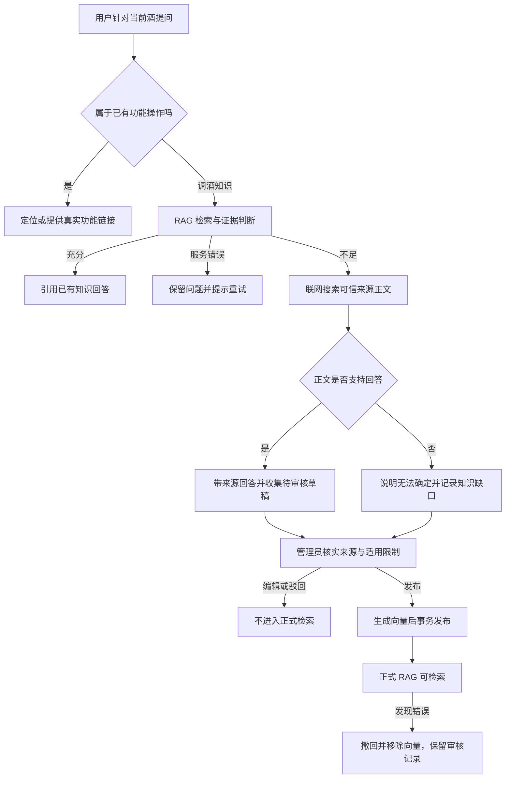

# 问答知识自动收集与人工发布

> 历史记录：保留当时的设计、结果及限制，不代表当前实现。当前版本见 [文档导航](../README.md)。

更新：2026-09-15。本文定义本轮实现；远程迁移与真实联网是否完成，以实现说明中的验证记录为准。

## 功能目标与用户场景

用户针对当前酒提问，已有功能先解决操作需求；RAG 无足够依据时联网补足知识。可用答案带来源展示，同时积累待审核知识。用户无需点击反馈。自创配方只进入私人收藏，不向公共知识库自动贡献。

## 处理策略



每个 v2 请求最多一次 RAG 检索、一次联网搜索、一次联网证据回答。沿用请求整体截止时间与用户额度；超时不无限重试。索引错误不触发联网。网络资料作为不可信证据输入，不能覆盖系统指令或生成页面操作；引用必须属于真实返回来源，资料冲突或缺关键依据时不生成确定结论。

默认使用 MiniMax Server Tools 联网搜索，复用服务端 `MINIMAX_API_KEY`，搜索模型通过 `MINIMAX_SEARCH_MODEL` 配置，默认 MiniMax-M3；原有对话模型不变。只接收实际服务器搜索调用对应的结果，过滤可信域名、去重后最多5条。返回内容是搜索摘要而非网页全文，只能支持摘要明确提供的事实；不足时记录知识缺口，不补编细节。自动收集后仍需人工审核发布。域名列表见 `src/lib/knowledge/review/search.ts`。接口依据：[MiniMax 官方 Server Tools](https://platform.minimax.io/docs/guides/server-tools)。该能力为 Beta，费用以账户账单为准。设置 `KNOWLEDGE_SEARCH_PROVIDER=tavily` 并提供 `TAVILY_API_KEY` 可切回原正文检索。

## 数据与展示内容

- `knowledge_candidates`：问题、适用酒名、SHA-256 规范化指纹、草稿、来源与正文摘录、首次/最近出现时间、次数、状态、修订号及合并目标。
- `knowledge_reviews`：管理员、操作、前后内容快照、核实说明和操作时间。
- `rag_chunks`：只有发布事务才写入 `web-reviewed-v1` 向量；待审草稿不在检索 SQL 范围内。
- 不保存完整聊天、用户收藏或用户ID到候选条目；提交检索及保存的问题去除常见邮箱、号码和链接。此规则不等于保证所有个人信息都被识别，运营仍需复核草稿。
- 相同规范化问题与酒名重复出现时增加次数，不覆盖人工编辑。相似但措辞不同的条目由管理员核对后合并；不声称已经实现全自动语义去重。
- 后台展示可能相关的种子知识及其他已发布条目，帮助核对重复、适用条件和冲突。不能把列表提示称为自动事实核查。
- 状态：`gap` 知识缺口、`pending` 待审核、`published` 已发布、`rejected` 已驳回、`merged` 已合并。

## 接口与权限

页面 `/admin/knowledge`；API `GET /api/admin/knowledge` 返回最近100条候选。所有请求复用 `requireAdmin`，普通用户不能读写待审内容。

`POST /api/admin/knowledge` 请求：

```json
{
  "id": "web-0123456789abcdef0123456789abcdef",
  "revision": 1,
  "action": "publish",
  "draft": {
    "title": "知识标题", "aliases": ["相似问法"], "category": "调酒问答",
    "answer": "已核实的回答", "scope": "适用条件与限制",
    "sources": [{"title": "来源名称", "url": "https://example.com/source"}]
  },
  "note": "核实来源、限制和冲突的说明"
}
```

`action` 支持 `save/publish/reject/unpublish/merge`；合并另外提交 `mergeTarget`，且目标必须已发布。合并只归并记录、移除重复向量，不自动拼接答案。需要更新目标内容时，先编辑并重新发布目标。

401/403 为身份或权限问题；400 为参数/审核信息不足；409 为修订冲突或不适用操作；503 为数据库或服务不可用。返回不包含密钥或连接串。

## 后端操作

| 操作及用途 | 前置条件 | 步骤 | 预期结果 | 失败处理 |
|---|---|---|---|---|
| 初始化审核表 | 已确认目标数据库；审查所有待执行迁移 | `npm run db:status`，核对后 `npm run db:deploy` | 应用 `20260915000000_add_knowledge_review`；RLS阻止浏览器直读 | 检查连接、基线和权限，不 reset |
| 配置搜索 | MiniMax API Key 可调用 M3 Server Tools | 配置 `KNOWLEDGE_SEARCH_PROVIDER=minimax`、`MINIMAX_SEARCH_MODEL=MiniMax-M3`，复用 `MINIMAX_API_KEY` 后重启 | RAG不足时返回有来源的搜索摘要 | 不支持工具、失败或摘要不足时记录知识缺口，不宣称找到答案 |
| 审核草稿 | 管理员已登录 | RAG后台 → 审核联网补充的问答知识 → 选择条目 | 展示草稿、来源、限制与相关知识 | 列表失败检查迁移和管理员权限 |
| 发布 | 答案、范围、来源和核实说明完整 | 点击“审核通过并发布” | 向量生成后事务更新知识、状态及审核快照 | 向量失败不发布；409刷新后重新审核 |
| 验证发布 | 已发布条目 | RAG测试台输入原问题，并测试相邻/反例问题 | 能检索条目；答案不超出依据 | 修改并重新发布，或撤回 |
| 撤回 | 已发布条目 | 点击“撤回发布” | 下次查询不再命中该条向量；保留审计记录 | 检查事务失败后重试 |
| 重建索引 | 嵌入服务可用 | `npm run rag:ingest` | 种子与已发布动态知识用相同profile重建 | 并发内容变化则整次回滚并重试 |

本轮已核对并应用候选表新增迁移。后续环境仍需按上述步骤审查目标与待执行项。已有种子入库命令会处理全部知识，不要把改码等同于数据发布。

## 异常规则与限制

收集写库失败不会丢弃已有来源支持的当次答案；服务日志记录 `knowledge_collection_failed`，此情况下不能承诺该条已收集。当前没有持久重试队列，运营需监测日志。用户取消或整体截止可能中止联网步骤。常见个人标识过滤、来源域名限制和引用ID校验都不能替代人工内容审核。

## 验收标准

| 前置条件 | 用户输入/操作 | 预期处理 | 展示结果 | 失败判定 |
|---|---|---|---|---|
| RAG已有充分依据 | 对应知识问题 | 不联网、不新建草稿 | 现有知识引用 | 重复联网或自动发布 |
| RAG证据不足，可靠网页正文可用 | 未覆盖的调酒问题 | 联网回答并收集 | 来源可点；后台待审核 | 把摘要或无来源结论当依据 |
| 来源不足、冲突或搜索失败 | 调酒问题 | 保存知识缺口 | 明确无法确定 | 编造确定答案 |
| 草稿尚未发布 | RAG检索原问题 | 排除草稿 | 不引用待审条目 | 草稿泄漏到正式检索 |
| 管理员核实完成 | 发布 | 生成向量后原子发布 | 状态与检索同步 | 状态成功但索引缺失 |
| 两管理员同时编辑 | 使用旧revision发布 | 拒绝过期修改 | 刷新提示 | 覆盖他人审核 |
| 已发布知识发现错误 | 撤回 | 删除向量并审计 | 后续不命中 | 撤回后仍可检索 |
| 普通用户或匿名用户 | 请求审核API | 拒绝访问 | 401/403 | 可读取/修改草稿 |

## 当前验证记录（2026-09-16）

知识审核迁移已应用，`npm run test:knowledge:live` 的7项真实数据库/向量检查通过，测试记录全部回滚。尚未配置搜索密钥，真实联网查找未执行；不能将模拟来源测试称为真实联网通过。报告与限制见[实现记录](companion-implementation.md)。

### 2026-09-16 MiniMax 接入验证

现有 Key 调用 M3 返回了 `server_tool_use` 与 `web_search_tool_result`，包含 IBA 帕洛玛配方链接及摘要。M2.5 在同样请求下仅返回客户端 `tool_use`，因此搜索单独使用 M3。此验证证明搜索接口可用，不代表完整 RAG → 联网 → 入库链路已通过真实端到端验收；没有自动发布测试资料。
