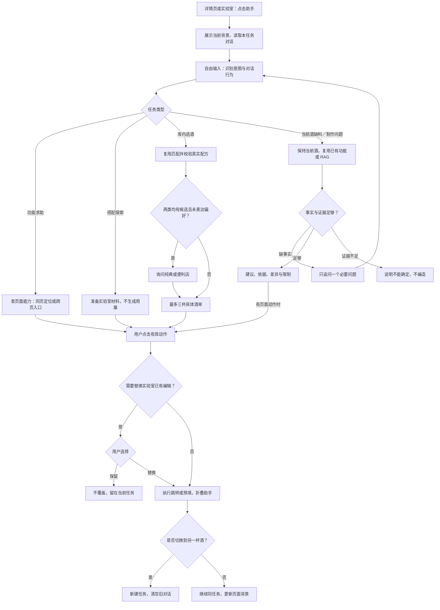

# 悬浮助手交互与完整任务流程

> 历史记录：保留当时的设计、结果及限制，不代表当前实现。当前版本见 [文档导航](../README.md)。

更新：2026-09-14；状态：悬浮交互主路径已接入，`/ask` 兼容保留；验证范围见 [实现说明](companion-implementation.md)。

## 1. 入口与视觉

| 页面 | 入口 | 默认背景 |
| --- | --- | --- |
| 首页、浏览列表、我的记录 | 不显示悬浮入口 | 无 |
| 经典酒详情 | 小圆形助手按钮 | 当前经典酒与配方版本 |
| 便利店调酒详情 | 小圆形助手按钮 | 当前便利店配方与版本 |
| 酒精实验室 | 小圆形助手按钮 | 当前材料及编辑值 |

不自动展开、不抢占主按钮。自由输入，不放预设问题按钮。移动端使用约三分之二高度抽屉，可拖动展开；保留关闭按钮、键盘操作、焦点返回和屏幕阅读标签。电脑预览也将抽屉与遮罩限制在手机页面容器内。回复中的动作使用原产品按钮和卡片样式。

流程图中的“任务类型／需要哪种帮助”表示后台意图识别，不展示为开场分类菜单。首次展开显示当前背景、对话区及自由输入框；没有历史消息时保持空对话状态，不要求先选帮助类型。两类配方都有有效候选且用户未表达偏好时，才在对话中展示“经典酒／便利店调酒”选择按钮，同时保留文字回答；覆盖实验室编辑时才展示“保留／替换”确认。这些按需选择不属于预设问题入口。

第二页及其子页面应统一字体层级、间距、边框、按钮主次、返回导航和反馈样式；具体组件与视觉数值在实施时依据现有设计资产确定，本轮没有完成视觉改造。

### 操作步骤与页面反馈

功能目标：用户在原页面得到帮助，明确选择下一步后再交接到已有功能。以下描述为交互验收基准；回复具体措辞统一维护在 [回复规范](agent-response-guidelines.md)。

| 步骤 | 前置条件／用户操作 | 处理策略 | 页面展示与反馈 | 异常规则／验收 |
| --- | --- | --- | --- | --- |
| 入口 | 进入允许的详情页或实验室 | 读取当前背景，不发起模型请求 | 显示圆形入口，保持主流程可操作 | 列表不显示；A01 |
| 展开 | 用户点击入口 | 恢复本任务状态 | 当前酒名或实验室背景、对话区、输入框；不自动开场 | 不抢页面位置；A02 |
| 输入 | 自由输入并发送 | 附本任务背景，区分配方值和实际值 | 显示用户消息及处理状态，不强制填写额外表单 | 输入不合法时提示修正；A02、A11 |
| 回复 | 获得工具或知识结果 | 按回复类型组织内容 | 解释、来源、追问或真实酒卡；按钮独立展示 | 不把失败显示为成功；A05、A10、A15 |
| 同页定位 | 用户点击有效定位按钮 | 再次核对页面及目标 | 折叠面板，滚动到目标并突出显示，便于继续操作 | 目标不存在则不执行；A19 |
| 跨页跳转 | 用户点击有效链接 | 校验目标和任务版本 | 到达指定功能或酒单，折叠助手，结束离开页面的旧对话 | 旧任务动作不得误执行；A07、A14 |
| 实验室预填 | 用户点击带材料入口 | 只携带识别材料与已有明确用量；不得生成缺失用量 | 无编辑冲突时带入材料，未知用量留待原流程处理 | A03；原流程若不支持未知用量，需先补交接能力 |
| 覆盖确认 | 预填将替换已有编辑 | 用户选择前不更新编辑状态 | 展示保留／替换两项明确选择 | 关闭确认视为不执行；保留时不覆盖；A04 |
| 切换酒款 | 用户打开另一杯酒 | 新建任务并更新背景 | 展示新酒，旧对话清空 | 旧实际情况不得沿用；A14 |
| 折叠重开 | 用户暂时关闭助手 | 保留本任务与页面位置 | 再打开可继续；后台结果仅归属原任务 | 旧结果不自动展开面板；A02、A14 |
| 取消／失败 | 用户取消或请求失败 | 取消待处理动作，或保留问题供重试 | 显示对应状态，原工作流可继续 | 不重复自动调用；A12、A16 |

这里携带“已有明确用量”仅指用户明确输入或已有编辑值，仍不是实际倒入事实；只提到材料名称的搭配问题不能补数字。
## 2. 完整流程图

零候选时不输出空壳酒卡，而是说明未匹配到并提供现有筛选入口。指定酒名直接查该酒，绕过无意义的类别询问。纯答案无需点击动作。

## 3. 上下文与任务生命周期

以下为产品上下文概念，实际 v2 字段见 [服务设计](ai-service-design.md)，并非所有概念均为独立 API 字段：

| 信息 | 来源 | 使用限制 |
| --- | --- | --- |
| taskId、contextVersion | 应用生成 | 判断任务归属与异步回复是否过期 |
| pageType、recipeId、recipeVersion | 页面及配方数据 | 不由模型猜测 |
| recipeIngredients | 配方原始值 | 仅说明配方要求 |
| editorIngredients | 实验室编辑状态 | 可用于交接，不能视为实际倒入 |
| confirmedFacts | 用户明确陈述 | 记录来源轮次；纠正时替代对应旧事实 |
| pendingQuestion | 当前必要追问 | “没有”“300”等先按该字段解释 |
| proposedAction | 受控工具生成 | 点击前重新校验页面、配方和有效性 |

折叠、重新展开保留任务；跳转后更新背景。换到另一杯酒创建新任务，旧对话结束，但旧杯的缺料、实际用量和故障不注入新任务。异步旧请求完成后不得写入新任务或执行旧动作。取消清除待执行动作与追问；新问题可重新开启。

首版对话以会话内临时状态为目标，不承诺跨设备记忆；当前只保存在内存中，同杯收起再展开保留，离页、换杯或刷新清空；最多24条消息，向服务端发送最近12条。

## 4. 关键对话样例（验收脚本，不是模型固定答案）

**实验室交接**：用户“橙汁和伏特加配起来什么味道？”→ 助手给“到实验室查看搭配”入口 → 点击检查已有内容 → 无内容则带入两项材料；有编辑则询问保留或替换。未经用户选择不覆盖、不补毫升数。

**两类候选**：用户“这些材料能做什么？”→ 真实匹配发现两类均有结果 → 问“想看经典酒还是便利店调酒？”→ 用户选择 → 最多三杯 → 点击直达所选酒单。

**当前酒缺料**：用户在玛格丽特详情问“缺其中一种材料怎么办？”→ 问尚未明确的缺料项 → 问手边有哪些材料 → 先查站内酒库及知识，不足再联网 → 给替代选项、差异和来源链接，保留现有快捷入口。已知信息跳过追问，不能自动改推另一杯。

**数量纠正**：用户“刚才说错了，实际加的是30毫升”→ 仅在指代明确时更新相应实际事实；不清楚是哪种材料时问清，不修改配方原始值。

**失败恢复**：页面动作目标已不存在 → 提示入口失效并提供可用页面入口；RAG 超时 → 说明查询未完成，保留问题供重试，不显示假引用。
