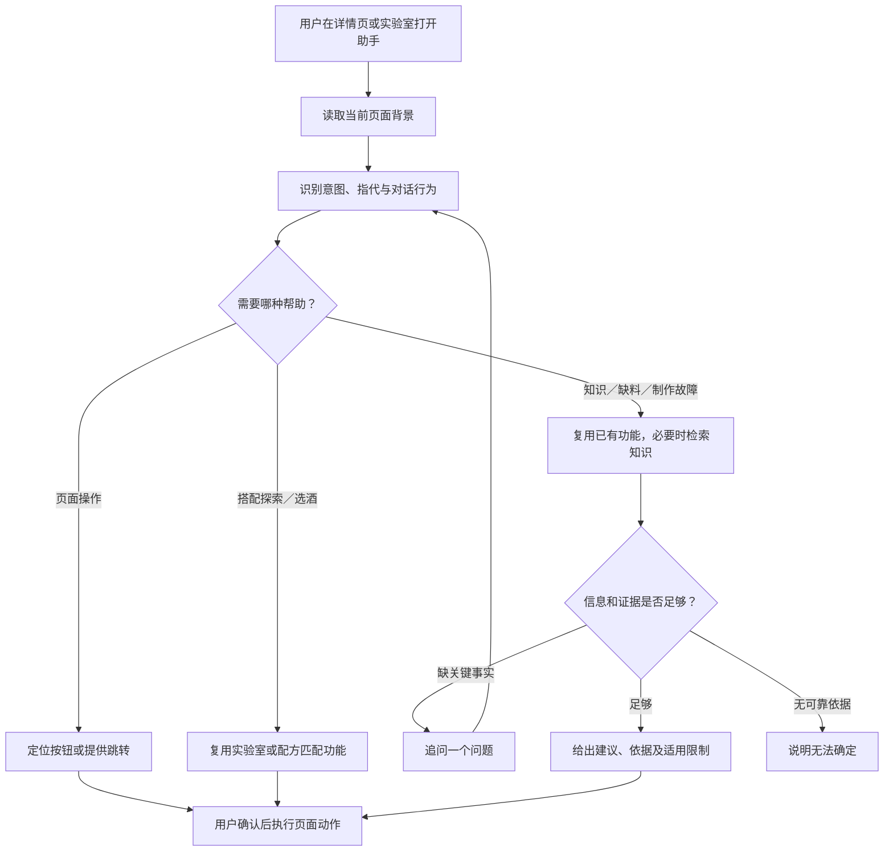

# Agent 决策、意图识别与边界

更新：2026-09-14。v2 已接入悬浮助手，v1 保留独立问答兼容；接口与验证范围见 [实现说明](companion-implementation.md)。

## 1. 决策图（保留的产品主图）

说明：纯知识回答无需执行页面动作；只有返回有效操作入口时进入最后一步。这里的确认通常就是用户点击，覆盖实验室内容需要额外明确选择。

图中的“需要哪种帮助”是系统内部判断，不是用户需要点击的分类菜单。用户直接输入问题，系统按识别结果选择对应处理路径；只有缺少影响下一步的信息时才向用户澄清。

## 2. 对话策略设置

### 1）功能目标与识别顺序

识别用户希望完成的任务，并判断这条消息是在提出新问题、回答追问、纠正事实、反馈结果还是取消。读取当前页面、当前酒和上一轮追问后再选工具，避免将“没有”“300”“是的”误判为选酒。

### 2）意图、功能调用与输出

以下为产品决策规则。v2 已接入共享匹配与受控页面动作；功能不存在时不能仅用文案宣称可操作。

| 意图分类 | 用户示例 | 工作流／知识调用 | 回复策略与展示 | 异常处理 | 验收 |
| --- | --- | --- | --- | --- | --- |
| 功能操作咨询 | “在哪里改成便利店版？” | 查页面能力注册表 | 说明功能位置；同页定位或跨页入口 | 目标不可用时不展示失效动作 | A19 |
| 材料搭配探索 | “橙汁加伏特加什么味道？” | 实验室交接 | 材料摘要和实验室按钮，不补用量 | 材料含义不明时澄清；覆盖按交互规范确认 | A03、A04 |
| 库内配方查找 | “这些材料能做什么？” | 现有匹配与排序 | 条件满足才问类别；最多三杯真实酒单，沿用 App 卡片点击展开 | 零结果明确说明，不自造配方 | A05、A06、A07 |
| 指定酒单查找 | “打开玛格丽特” | 真实配方及路由查询，支持部分名称和小幅拼写误差 | 具体酒单入口，不再询问类别 | 多个可能名称时展示候选或澄清；未知名称不造链接 | A07 |
| 当前配方缺料 | “这杯没有橙汁怎么办？”“没有椰奶，椰汁可以吗？” | 确认缺料和用户提出的替代候选或可用材料后查站内酒库／RAG，不足再联网 | 保留当前酒，给适用选项、差异和来源链接，保留快捷入口 | 具体候选已明确就直接检索；未知条件才追问；无证据不报精确比例 | A08、A09 |
| 制作步骤咨询 | “这杯放多少冰？” | 当前配方及制作知识 | 适用当前酒的说明和依据 | 必要事实缺失时只问一项 | A10 |
| 制作问题排查 | “已经混好了，为什么分层？” | 先确认实际材料和操作，再查站内资料，不足联网 | 可能原因、补救建议和来源链接 | 已知事实不重复问；不能用配方值代替实际操作 | A20 |
| 知识解释 | “为什么要过滤？” | RAG | 回答问题及引用，不强制选酒 | 无证据与查询失败分开提示 | A21、A15、A16 |
| 范围外 | “帮我写简历” | 不调业务或知识工具 | 简要说明助手可提供的帮助 | 不强行改写为调酒请求 | A22 |
| 不明确 | 无背景的“300” | 先澄清 | 询问数量对应对象 | 不猜单位、材料或任务 | A11 |

兼容 v1 代码意图枚举是 `recommend / knowledge / guide / troubleshoot / change / operate / out_of_scope / unclear`，不是上表名称。v2 使用独立意图与动作契约；当前与后续契约见 [AI 服务设计](ai-service-design.md)。

### 3）多轮策略

| 对话行为 | 用户示例与背景 | 状态处理 | 回复／下一步 |
| --- | --- | --- | --- |
| 新任务 | “再看看另一杯” | 明确新目标；换酒时隔离旧事实 | 按新目标选工具 |
| 回答追问 | 问缺什么后回答“橙汁” | 填充当前待回答字段 | 继续当前酒的缺料任务 |
| 纠正 | “刚才说错了，是30毫升” | 明确指代才替换旧事实 | 指代不清只追问，不改配方原始值 |
| 结果反馈 | “还是太甜了” | 保留目标，使用用户新陈述 | 必要时问实际操作，不假定建议已执行 |
| 取消 | “先不改了” | 清除追问及待执行动作 | 简短确认，不继续工具调用 |

任务关系为继续或新建。混合请求拆成待处理事项：选酒交由匹配，知识仍需回应；缺信息的事项可追问，已获得的有效知识不丢弃。不要为了一个未完成事项无限循环调用工具。验收见 A11–A14。

## 3. 候选和缺料规则

1. 先标准化材料名称；关键材料含义不明时问一个问题。
2. 调用现有工作流的匹配逻辑，按真实类别分组。材料齐全与缺材料候选不能混称“现在就能做”。
3. 只有经典、便利店两类都存在有效候选且用户未表明偏好时询问类别；指定经典或指定酒名不再问。
4. 输出至多三杯，材料齐全的候选先按工作流排序；其后可列出至少匹配两种且只缺一种材料的接近选择。每杯显示匹配原因、缺料事实和具体入口。零结果诚实说明，可提供现有筛选功能入口，不凭空造酒。
5. 用户在已选酒中问缺料时，保留该酒。先确认缺少哪种材料；已提出具体替代候选时直接检索适用性，不把候选当作已拥有，也不追问全部库存。未提出候选时才问手边有哪些可用材料。之后先查站内酒库和资料，证据不足再联网，给替代选项、风味差异及来源链接，并保留已有快捷入口。其他酒的材料组合只能作为搭配参考，不能据此声称等味、等量替换。
6. 实际故障先确认用户实际使用的材料和操作，再检索并建议。每次只问一项必要信息；用户开始新问题时停止沿用旧追问，取消清除待回答状态。

“缺一种材料”不是让助手重做首页选酒流程的触发器，而是用户明确求助或解释真实候选的约束。

## 4. 工具边界（目标）

| 工具职责 | 确定性约束 |
| --- | --- |
| 读取页面与当前配方 | 校验 recipeId、页面版本；编辑值不转成实际倒入量 |
| 查找页面能力 | 由注册表返回可执行动作，不接受模型生成 JS、选择器或任意 URL |
| 匹配库内配方 | 复用现有逻辑和数据，服务端组装身份与链接 |
| 检索制作知识 | 只使用通过版本检查的知识索引，输出证据与限制 |
| 提出页面交接 | 用户点击执行；覆盖前确认；过期动作失效 |

兼容 v1 工具仍为 `read_recipe / search_knowledge / check_capacity / clarify / finish`。v2 由意图识别后编排共享配方查找、匹配、受控动作和 RAG；没有另建六杯配方目录，也不把 v1 的六步循环上限误写为 v2 调用方式。具体见 [实现说明](companion-implementation.md)。

## 5. 停止、失败与信任边界

缺关键事实只问一个影响下一步的问题；证据不足与服务失败分别提示。重复无新增信息时结束当前工具链，允许用户补充或返回工作流。保留当前已有的调用上限与截止时间，后续按真实延迟评估调整。

用户输入、页面文本和检索文档都是数据，不能修改系统边界。引用存在不等于论断被支持；人工评估必须检查适用条件。身份、权限、配额、动作校验由后端执行。任何配方文本均不能授权写入用户记录。

## 知识不足分支（2026-09-15）

原判断图中的知识检索分支现扩展为：RAG 证据不足 → 受限来源联网检索 → 有依据则带来源回答 → 自动保存待审核条目 → 管理员发布后更新索引。内部操作问题不进入联网；服务故障返回重试。完整图见[知识闭环](knowledge-learning.md)。
